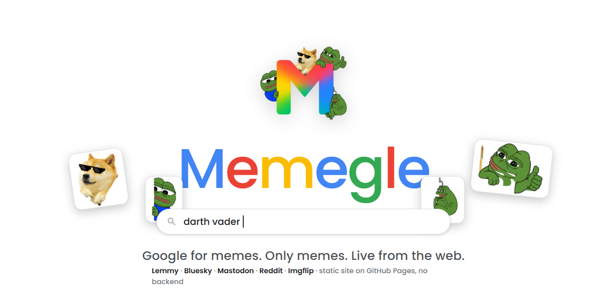
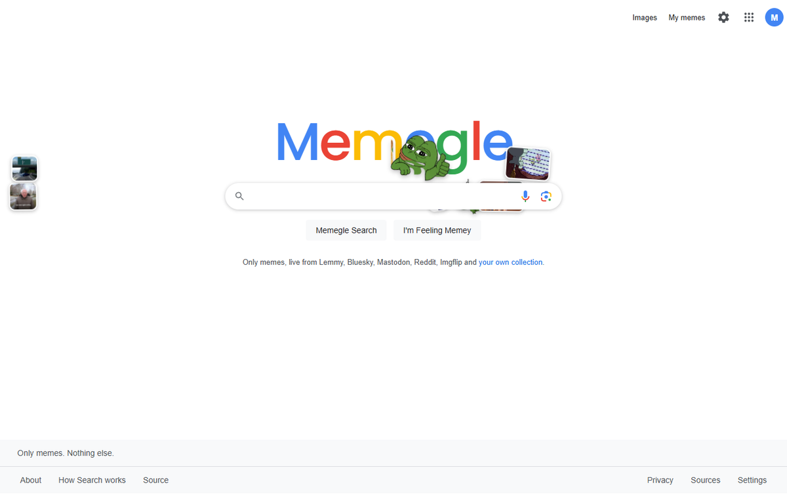
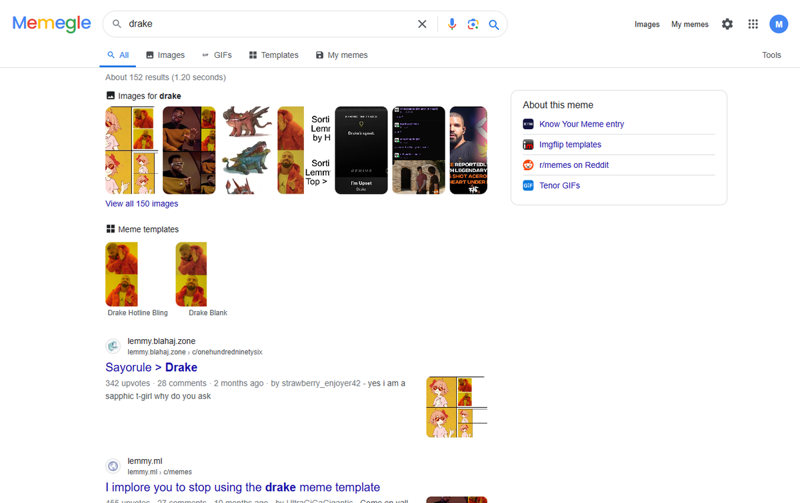
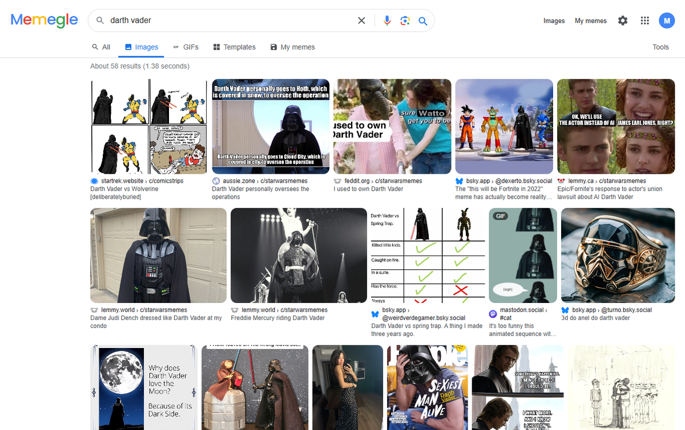
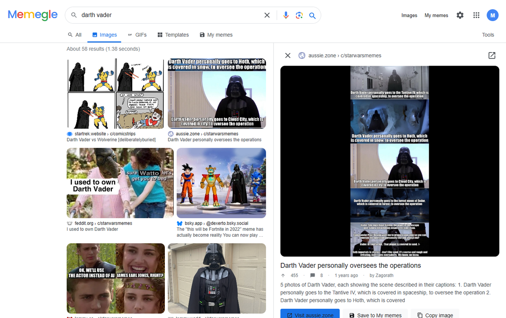
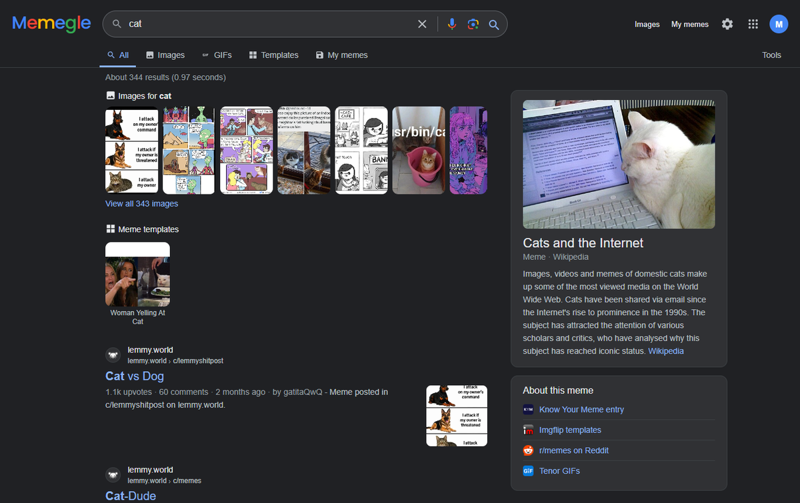
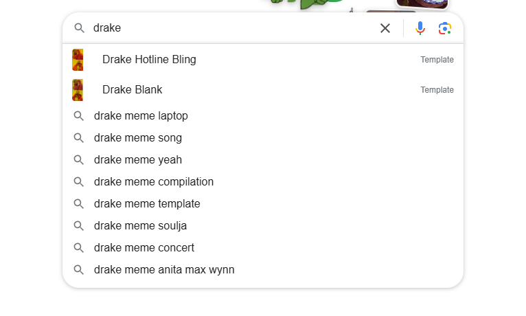

<p align="center">
  
</p>

<h3 align="center">Google for memes. Only memes. Live from the web.</h3>

<p align="center">
  <a href="https://justbuildsstuff.github.io/Memegle/"></a>
  
  
  <a href="LICENSE"></a>
</p>

<p align="center">
  <a href="https://justbuildsstuff.github.io/Memegle/"><b>Open Memegle</b></a> ·
  <a href="https://justbuildsstuff.github.io/Memegle/#/search?q=darth+vader&tab=images">try "darth vader"</a> ·
  <a href="https://justbuildsstuff.github.io/Memegle/#/search?tab=images">trending now</a>
</p>

---

Memegle is a meme-only search engine with the look and behaviour of Google Search. Type anything and
get memes from across the web, nothing else. It is a static site: every search runs in your browser
against public APIs, there is no server, no account and no tracking.

## Preview

<table>
  <tr>
    <td width="50%"><br><sub><b>Home.</b> Meme characters and trending templates walk through the search bar.</sub></td>
    <td width="50%"><br><sub><b>All.</b> Image strip, templates, web-style results, knowledge panel.</sub></td>
  </tr>
  <tr>
    <td><br><sub><b>Images.</b> Masonry grid from Lemmy, Bluesky, Mastodon, Reddit and Imgflip.</sub></td>
    <td><br><sub><b>Viewer.</b> Visit the source, caption the template, save, copy, download, find similar.</sub></td>
  </tr>
  <tr>
    <td><br><sub><b>Dark mode.</b> Follows the system or set it in Settings.</sub></td>
    <td><br><sub><b>Suggestions.</b> Live meme suggestions as you type, plus templates and your history.</sub></td>
  </tr>
</table>

## Features

- **Live, meme-only search.** Lemmy meme communities (27 searched directly plus a full-text search on
  seven instances limited to image posts in meme communities), Bluesky posts with images or GIFs that
  say "meme" or carry #memes, Mastodon hashtag timelines, hot posts of meme subreddits and the Imgflip
  template list. Results stream in per source and are merged, de-duplicated and ranked by title match,
  upvotes and freshness.
- **Google-style everything.** Suggestions as you type (live from Google, meme-specific), "Did you mean",
  tabs for All, Images, GIFs, Templates and My memes, Tools for sort, SafeSearch and source filters,
  "People also search for", a Wikipedia knowledge panel, "I'm Feeling Memey", Lens, voice search.
- **Viewer panel.** Open the source, caption the template on Imgflip, save to My memes, copy, download,
  find similar, more like this.
- **My memes.** Your private collection in the browser: upload by drag and drop or paste, save any result,
  describe memes with Florence-2 running locally (WebGPU or WASM) or an OpenAI-compatible vision API,
  tags, folders, BM25 or vector search, export and import. Nothing leaves your device.
- **Optional GIF sources.** Add free API keys for Tenor, Giphy or Imgur in Settings; keys stay in the browser.
- **Meme parade.** Doge and friends walk along and through the search bar on the home page. Drop more
  transparent PNGs into `assets/characters/` and list them in `index.json`.

## Sources

| Source | Endpoint | Key |
|---|---|---|
| Lemmy | `/api/v3/search` per community and global on lemmy.world, lemmy.ml, sh.itjust.works, lemmy.dbzer0.com, lemmy.blahaj.zone, sopuli.xyz, programming.dev; `post/list` Hot for trending | no |
| Bluesky | `app.bsky.feed.searchPosts` (`<query> meme`, `tag=memes`), image and Tenor GIF embeds | no |
| Mastodon | `timelines/tag/<tag>?only_media=true` on mastodon.social | no |
| Reddit | meme-api.com (`/gimme/<subreddit>/50`), filtered by relevance | no |
| Imgflip | `api.imgflip.com/get_memes`, top 100 templates | no |
| Wikipedia | Action API for the knowledge panel | no |
| Google suggest | JSONP `suggestqueries.google.com` for suggestions and spelling | no |
| Tenor, Giphy, Imgur | search and autocomplete | yes |

Community and subreddit lists are editable in Settings. Reddit's own API and most GIF APIs block anonymous
browser requests, which is why GIF search needs a key.

## Run locally

```sh
git clone https://github.com/justbuildsstuff/Memegle.git
cd Memegle
python tools/serve.py        # http://127.0.0.1:8000
```

ES modules need an HTTP origin, `file://` will not work. Any static server with correct `.js` MIME types is fine.

## Project layout

```
index.html            shell, loads js/app.js
css/memegle.css       Google-style theme, light and dark tokens, parade and wordmark animation
js/app.js             views, routing, live sessions, actions
js/sources.js         source adapters, ranking, de-duplication, sessions
js/search.js          BM25, suggestions, did-you-mean, vector ranking for My memes
js/store.js           IndexedDB library, settings, history
js/ai.js              Transformers.js (Florence-2, MiniLM) and OpenAI-compatible provider
assets/characters/    parade characters (transparent PNGs + index.json)
icons/                favicons and app icons
docs/                 banner and screenshots for this README
tools/                serve.py, bump_version.py, cut_characters.py, build_index.py
```

After a deploy run `python tools/bump_version.py` so browsers pick up the new files immediately.

## Credits and license

Memegle grew out of [Meme Search](https://github.com/meme-search/meme-search) by neonwatty, whose
features (AI descriptions, tags, folders, vector search) live on under My memes. Apache-2.0, see `LICENSE`
and `NOTICE`. Search results belong to their authors and platforms; Memegle links to them and does not host them.
